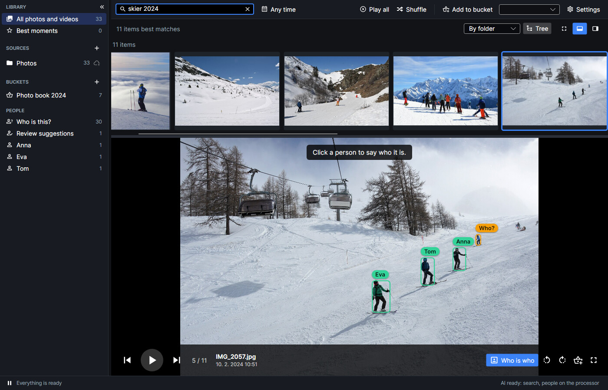
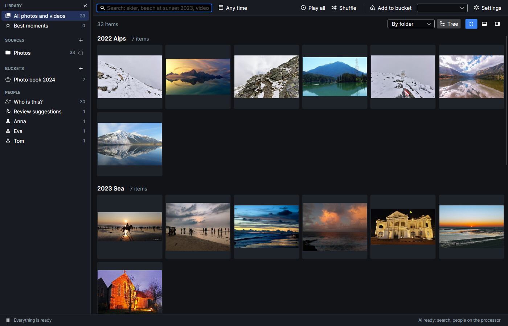

# MomentFinder

> [!WARNING]
> **Not ready yet: please do not download or install it.**
> We are debugging MomentFinder right now. It changes every day and things still break.
> This note goes away with the first version meant for use.

A photo and video browser that finds the moment you are looking for: by what is in the picture and by who is
in it. The AI runs on your own computer (the models are downloaded once, then it works offline).
Windows, Linux and macOS.



## What it does

**Find**

- **Search by description**, in Czech or English: `skier 2024`, `beach at sunset`, `video birthday`.
  Videos are searched too and start at the found moment.
- **People**: click somebody once and say who it is. They are then found through the years by the face, and
  within one day by the clothes, so a skier in a helmet and goggles is found too.
- **Best moments**: the parts of your videos where the people you named are big on the screen.

**Look**

- **Play all, Shuffle, slideshow**: videos whole, or only the part that matches.
- **360 photos and videos** (Insta360): look around, the horizon stays level, the view can follow one person.
- **Buckets**: collect photos for a photo book, put them in order, copy them out numbered.

**Keep**

- **Your folders stay where they are**: on the disk, in an S3 compatible storage (IDrive e2, Amazon S3),
  on OneDrive or Google Drive.
- **A folder backed up or cloned to the cloud**, encrypted if you want. A video in the cloud starts playing
  in about a second, without being downloaded first.
- **One library for the family**: several computers share the names, the people and the buckets.
  One recovery string brings the library to a new computer.



Each of these in detail: [How MomentFinder works](docs/details.md).

## For developers

.NET 9 SDK. Video needs ffmpeg (thumbnails, frames) and libVLC (playback), the cloud needs rclone: put them on
the PATH, on Linux install `vlc` (or `libvlc5 vlc-plugin-base`). The installers bundle ffmpeg and rclone
(and libVLC on Windows and macOS).

```
dotnet run --project src/MomentFinder.App
dotnet test
```

- Installers: [build/README.md](build/README.md).
- AI acceleration: DirectML on Windows (any GPU), CoreML on macOS, CPU elsewhere; on Linux with NVIDIA build
  with `-p:OrtCuda=true`. `MOMENTFINDER_DEVICE=cpu` forces the CPU.
- The library lives in the user's local application data (`MomentFinder/`); `MOMENTFINDER_DATA` points it
  elsewhere.
- `MomentFinder.Cli` is the same library without the window, for tests and scripts:
  `dotnet run --project src/MomentFinder.Cli -- help` lists its commands.

| Project | |
|---|---|
| MomentFinder.Core | SQLite index, scanner, thumbnails, vector index, search, buckets, people matching, cloud |
| MomentFinder.Analysis | ONNX Runtime models (SigLIP, faces, people), model download, `LibraryHost` |
| MomentFinder.App | Avalonia UI, libVLC player |
| MomentFinder.Cli | the same library without UI |

Scene embeddings are float16 rows in `vectors/scene.vec`, scanned exactly with SIMD; SQLite maps rows to
media and evaluates the filters first. Face and body embeddings are stored with their detections.

## Models

| Model | Use | License |
|---|---|---|
| SigLIP 2 base patch16 224 (ONNX by onnx-community) | search by description | Apache 2.0 |
| Helsinki-NLP OPUS-MT cs-en (ONNX by Xenova) | Czech queries translated to English first, which the search model understands much better | Apache 2.0 |
| InsightFace buffalo_l: SCRFD 10G + ArcFace R50 | faces | weights for non-commercial use only |
| YOLOX-s | people detection | Apache 2.0 |
| OSNet-AIN x1.0 MSMT17 | recognizing people by clothes | MIT |
| GeoNames cities1000 (data, not a model) | place names for GPS positions, offline | CC BY 4.0 (credit GeoNames) |

Before any commercial release the face models must be replaced (for example YuNet for detection and a
face recognition model with a commercial license).

## License

MIT, see [LICENSE](LICENSE). The installers bundle FFmpeg (GPL) and rclone (MIT); their licenses and sources are
listed in `tools/THIRD-PARTY.txt` next to the application. The AI models are downloaded on first use under their own
licenses. The photos in the screenshots are public domain (CC0) pictures from Wikimedia Commons.
